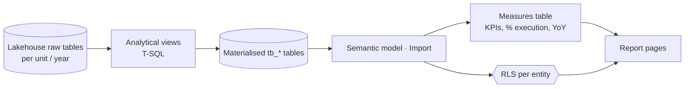

# Power BI — Public Procurement Execution Analytics

> **Case study** · Public-sector healthcare procurement (Portugal) · Power BI, DAX, T-SQL views on a Fabric Lakehouse, row-level security
>
> 🇵🇹 [Versão em português](README.pt.md)

Dashboards that track how much of what was planned for purchase has actually been awarded, by procurement scope, item and year, for a central purchasing body serving many hospitals. Each hospital sees only its own data.

This repository covers the **analytics layer**: the SQL views that shape the data for analysis, the DAX measures behind the KPIs, the semantic model and the security design. The data platform underneath (OneLake, pipelines, materialisation, gateways) is in [fabric-onelake-portfolio](https://github.com/Daimartinsk/fabric-onelake-portfolio).

*Client names, entities, item codes, table names and all figures are anonymised. Numbers in examples are illustrative.*

---

## What the dashboards answer

| Page | Question |
|---|---|
| Overview | How much has been awarded this year, and how does it compare with last year? |
| By scope | Which procurement programmes are behind on execution? |
| Comparison | How has execution evolved year over year? |
| Detail | Which items and processes are still in progress, and how much is missing? |

## How it's built



1. **Analytical views** ([`sql/`](sql/)) — consolidate years, compute working days between process milestones, prepare monthly/annual KPIs and forecast comparisons, so the report never does heavy row-level work.
2. **Semantic model** ([`docs/model.md`](docs/model.md)) — Import mode on materialised tables, a dedicated measures table, target star schema.
3. **DAX measures** ([`dax/measures.dax`](dax/measures.dax)) — awarded vs in-progress quantities, % execution by quantity and by number of processes, year-over-year with an integer year column, a combined KPI card.
4. **Row-level security** ([`docs/rls.md`](docs/rls.md)) — one report for all entities; each one sees only its rows.

## Analytical decisions worth showing

**"% execution" dilutes when new processes open.** If everything awarded so far is 100% and a new process opens next month, the % drops, not because anything got worse but because the denominator grew. I kept the measure, renamed it as a *current snapshot*, documented it in the measure description, and added a complementary measure so users don't read a drop as a failure. → [`docs/metric-design.md`](docs/metric-design.md)

**Quantity vs number of processes.** One large process still in progress can drag the quantity-based % down even when 9 of 10 processes are closed. Both views are offered side by side because they answer different management questions.

**Year-over-year without a date column.** The source has the year as an integer, so `SAMEPERIODLASTYEAR` fails. The measure uses `ALL` + `MAX(Year) - 1` instead.

**`AVERAGEX` over the right table.** Iterating a measures table (which has no rows) returns blank. The average must iterate the fact table so each row's context is turned into a filter for the measure.

## Repository map

```
├── sql/
│   └── analytical_views.sql     Views that shape data for the report
├── dax/
│   └── measures.dax             KPI, execution and YoY measures
└── docs/
    ├── model.md                 Semantic model, storage mode, star schema target
    ├── metric-design.md         Snapshot vs historical metrics, dilution, process count
    ├── rls.md                   Row-level security per entity
    └── report-design.md         Pages, visuals, conditional formatting, KPI cards
```

## Services I offer

- Power BI dashboards from requirements to publication
- DAX measures and semantic model design (Import / Direct Lake, star schema)
- Row-level security for multi-entity reports
- SQL views and data preparation on Microsoft Fabric

📫 **Contact:** daianamartinsk@gmail.com · [LinkedIn](https://www.linkedin.com/in/daiana-martins-37b636181)
