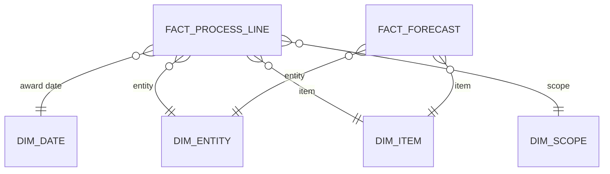

# Semantic model

## Storage mode
**Import**, reading materialised `tb_*` tables, with scheduled refresh after the daily data pipeline.

The model was originally DirectQuery against SQL views. Every visual on every report open sent SQL to the Lakehouse, and each view recomputed its joins and calculations. Moving to Import on materialised tables made report interaction independent of capacity load. The full story is in [fabric-onelake-portfolio](https://github.com/Daimartinsk/fabric-onelake-portfolio).

Repointing a table in Power Query is a one-line change:

```powerquery
Source{[Schema = "dbo", Item = "tb_UnitA_Forecasts"]}[Data]   // was "vw_UnitA_Forecasts"
```

The `tb_` table has the same schema as the view, so nothing downstream breaks.

## Structure
- **Fact tables:** one per business unit (process lines with quantities and values)
- **Reference tables:** calendar, entities, items, price lists
- **Measures table:** an empty table that only holds measures, organised in display folders

## Target: star schema
The current model still has many-to-many relationships between units, items and entities. The next step is:



Single-direction filters from dimensions to facts, bridge tables only where a real many-to-many remains.

## Operational note
Power BI pauses scheduled refresh on models whose reports haven't been opened for about two months. Seasonal reports need a check before their season starts.
